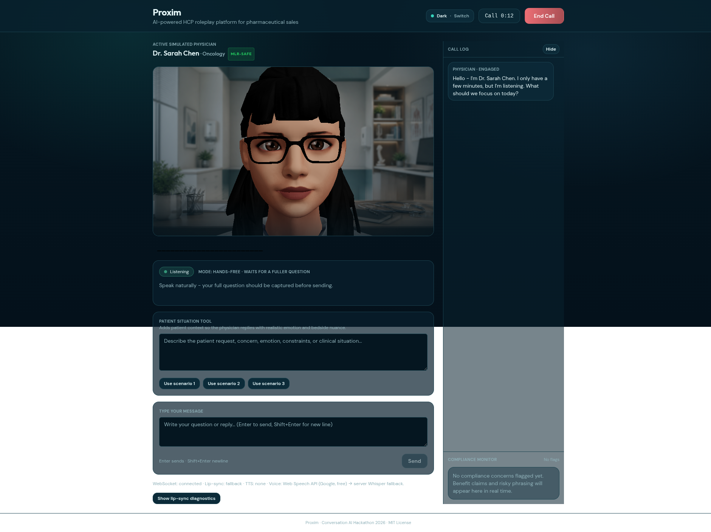
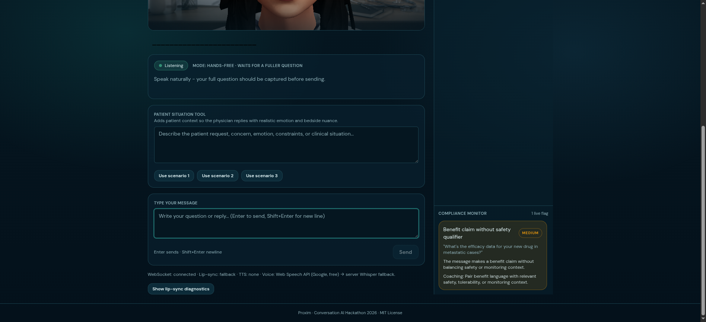

<div align="center">

# 🩺 Proxim

### Practice the hardest sales calls before you're in the room

[](https://client-five-ivory-90.vercel.app)
[](https://youtu.be/N4RtS9wSZoA?si=2QUX1ryt69F70uSG)
[](LICENSE)

🏆 **Top 5 of 200+ teams** · Conversation AI Hackathon 2026

</div>

---

Proxim drops a pharma sales rep into a live voice call with a simulated physician — not a script, not a quiz. The rep talks, a persona-grounded LLM talks back in character, a 3D avatar lip-syncs the reply, a compliance monitor flags risky phrasing **as it's said**, and the call ends with a coaching scorecard instead of a grade.

It's built end-to-end: real-time voice pipeline, WebSocket session orchestration, a 3D rendering layer, and an LLM/TTS stack with provider fallbacks — all shipped and verifiably running in production, not just on `localhost`.

## Screenshots

| Live call with a simulated physician | Real-time compliance flag |
| --- | --- |
|  |  |

## Live Demo

| | |
| --- | --- |
| 🌐 **App** | [client-five-ivory-90.vercel.app](https://client-five-ivory-90.vercel.app) |
| 🎬 **Demo video** | [youtu.be/N4RtS9wSZoA](https://youtu.be/N4RtS9wSZoA?si=2QUX1ryt69F70uSG) |
| 🔌 **API health** | [proxim-server.onrender.com/health](https://proxim-server.onrender.com/health) |
| 🔑 **Sign in** | see [Sign-In](#sign-in) below |

> Hosting: client on Vercel, server on Render's free tier. The server sleeps after 15 minutes idle — the **first request after a quiet period can take 30-60 seconds** to wake it before the call connects. If the avatar seems stuck loading, give it a minute and retry.

## Sign-In

The app sits behind a lightweight session-cookie gate — both the HTTP app and the WebSocket handshake check it, so there's no way to open a call without signing in first.

Ask whoever shared this link for the current demo username/password (configured via `AUTH_USERNAME` / `AUTH_PASSWORD` on the server, see [server/.env.example](server/.env.example)). Running locally, it defaults to `demo` / `proxim-demo`.

This is intentionally a single shared demo account, not a multi-user system — see [Known Limitations](#known-limitations).

## What the project demonstrates

- Real-time voice-in, avatar-response conversational flow
- Continuous multi-turn dialogue over WebSocket
- Five distinct HCP personas with different specialties, moods, and compliance styles
- Browser-rendered 3D avatar animation with lip sync and emotional motion cues
- Session-end scorecard for coaching and objection-handling review
- Reliable post-call debrief delivery with a scorecard wait state
- Real-time compliance flagging for risky rep phrasing
- Interruptible voice-to-voice turns for natural barge-in
- Session-cookie auth gating both the HTTP app and the WebSocket handshake
- Containerizable client/server deployment

## Architecture Overview

```text
Browser (React + Vite)
  - sign-in gate (session cookie)
  - microphone capture
  - transcript UI
  - persona selection
  - 3D avatar rendering
  - audio playback and diagnostics
            |
            | HTTP + WebSocket (cookie-authenticated)
            v
Server (Node.js + Express + ws)
  - session cookie issue / verify
  - session orchestration
  - persona loading
  - LLM response streaming
  - TTS generation
  - viseme generation
  - scorecard evaluation
  - avatar asset proxy/upload
```

### Front end

- React 18 + TypeScript + Vite
- React Three Fiber / Three.js avatar rendering
- Zustand state management
- Voice input, transcript, playback, diagnostics, and scorecard UI
- `src/auth/` — login screen + session gate wrapping the app

### Back end

- Node.js + Express + TypeScript
- WebSocket session transport, cookie-authenticated at handshake
- HMAC-signed session cookies (`src/auth.ts`) — no extra auth dependency
- Persona-driven prompt orchestration
- Groq, Anthropic, OpenAI, and ElevenLabs integration points

## Repository Structure

```text
client/             React application and avatar UI
  src/auth/            Login screen + session gate
  src/components/      Call UI (avatar, transcript, compliance monitor, scorecard, ...)
  src/hooks/           Session, audio, voice-input, theme hooks
  src/sdk/             Reusable WebSocket session API (useProximAvatarSession)
  src/store/           Zustand state
server/             Express/WebSocket orchestration service
  src/auth.ts           Session token sign/verify (HMAC, no external dep)
  src/routes/           HTTP routes (auth, session, avatar proxy)
  src/websocket/        WS message handler
docs/               Submission-ready technical notes, deployment guide, screenshots
```

## Personas Included

The current build ships with five physician personas:

- Dr. Sarah Chen, Oncology
- Dr. Raj Patel, Cardiology
- Dr. Linda Williams, General Practice
- Dr. Ji-Yeon Kim, Rheumatology
- Dr. Miguel Rodriguez, Hospital Medicine

Persona definitions live in:

- `client/src/config/personas.json`
- `server/src/config/personas.json`

## Local Setup

### Prerequisites

- Node.js 20 or newer
- npm
- At least one LLM/TTS/STT provider key

### Required and optional API keys

Minimum recommended setup:

- `GROQ_API_KEY`

Optional quality/fallback providers:

- `ELEVENLABS_API_KEY`
- `ANTHROPIC_API_KEY`
- `OPENAI_API_KEY`
- `LLM_PROVIDER` (`auto`, `groq`, `anthropic`, or `openai`)
- `OPENAI_CHAT_MODEL` (defaults to `gpt-4.1`)

Sign-in (optional to override, has working defaults):

- `AUTH_USERNAME` / `AUTH_PASSWORD` (defaults to `demo` / `proxim-demo`)
- `SESSION_SECRET` (generate with `node -e "console.log(require('crypto').randomBytes(32).toString('hex'))"`)

### 1. Install dependencies

```bash
npm install --prefix server
npm install --prefix client
```

### 2. Configure environment files

```bash
copy server\.env.example server\.env
copy client\.env.example client\.env
```

Then fill in your API keys in `server/.env`.

### 3. Start the server

```bash
npm run dev --prefix server
```

The API and WebSocket server run on `http://localhost:3001`.

### 4. Start the client

```bash
npm run dev --prefix client
```

The web app runs on `http://localhost:5173`. Sign in with `demo` / `proxim-demo` unless you overrode it.

## Docker Deployment

The repo includes a client container and a server container.

### Start both services

```bash
copy server\.env.example server\.env
docker compose up --build
```

Endpoints:

- Client: `http://localhost:8080`
- Server health: `http://localhost:3001/health`

For AWS EC2 deployment, scalability notes, and reviewer checks, see [docs/AWS_DOCKER_DEPLOYMENT.md](docs/AWS_DOCKER_DEPLOYMENT.md).

## Key Runtime Behavior

### Sign-in

- A single demo account (`AUTH_USERNAME` / `AUTH_PASSWORD`) gates the app.
- On success, the server sets an `httpOnly`, `Secure`, `SameSite=None` session cookie, HMAC-signed with `SESSION_SECRET` and verified with a timing-safe comparison.
- The same cookie is checked again at the WebSocket upgrade — an unauthenticated client cannot open a call even by hitting the socket directly.
- Session cookies expire after 24 hours; the client re-checks `/api/auth/me` on load and shows the login screen if the session is missing or expired.

### Voice input

- Browser speech recognition is used when available.
- A server-side transcription route is available as a fallback.

### Response generation

- Persona prompts shape the HCP identity, specialty, tone, and objection style.
- Responses stream back progressively rather than waiting for a full completion.

### Speech output and lip sync

- ElevenLabs is the preferred TTS path when configured.
- Groq TTS is used as a fallback.
- Visemes are generated from alignment data or synthesized from speech/text fallbacks.

### Scorecard

When the session ends, the conversation is evaluated across categories such as:

- clinical accuracy
- objection handling
- safety messaging
- dosing accuracy
- compliance language

The client now keeps the session transport alive briefly after `End Call` so the debrief can arrive reliably. If scoring fails or times out, the UI still falls back safely to the non-scorecard end state.

### Live compliance monitor

During a live session, rep messages are scanned immediately for rule-based concerns such as:

- off-label language
- unsupported superiority claims
- benefit claims without safety qualifiers
- absolute efficacy claims
- "guaranteed" or "risk-free" phrasing

Flags stream into a sidebar compliance monitor without blocking the physician response loop.

### Interruptible voice sessions

Assistant turns now carry turn IDs and can be interrupted mid-playback. When the user speaks over the avatar, the client can stop queued audio, clear the current turn, notify the server, and continue with the new utterance while preserving the safer mic-mute fallback mode in code.

## React Integration API

The client also exposes an internal React-facing session API under `client/src/sdk/` so the WebSocket protocol is not tied directly to the demo UI.

Current surface:

- `startSession(config)`
- `sendText(text, config)`
- `sendAudio(blob, config)`
- `interrupt()`
- `endSession(sessionId)`
- `onTranscript(handler)`
- `onAudioChunk(handler)`
- `onComplianceEvent(handler)`
- `onScorecard(handler)`

The reference app uses this SDK internally today, and another React app can adopt the same surface by composing `useProximAvatarSession()` and rendering its own UI around those callbacks.

## Environment Reference

### Server

See [server/.env.example](server/.env.example) for the full list. Main variables:

- `PORT`
- `GROQ_API_KEY`
- `ANTHROPIC_API_KEY`
- `ELEVENLABS_API_KEY`
- `ELEVENLABS_DEFAULT_VOICE_ID`
- `OPENAI_API_KEY`
- `LLM_PROVIDER`
- `OPENAI_CHAT_MODEL`
- `GROQ_STT_MODEL`
- `PERSONAS_PATH`
- `AUTH_USERNAME` / `AUTH_PASSWORD`
- `SESSION_SECRET`

### Client

See [client/.env.example](client/.env.example). Main variables:

- `VITE_WS_URL`
- `VITE_API_URL`
- `VITE_HTTP_SERVER_URL`
- `VITE_RPM_USE_PROXY`
- `VITE_RPM_USE_VITE_DEV_PROXY`
- `VITE_FORCE_SERVER_STT`
- `VITE_VOICE_USE_VAD`
- `VITE_DEFAULT_AVATAR_GLB`

## Demo Guidance

Recorded per [docs/DEMO_SCRIPT.md](docs/DEMO_SCRIPT.md) — see [Live Demo](#live-demo) above for the video link.

## Known Limitations

- Sign-in is a single shared demo account, not a multi-user system with individual accounts or signup.
- Session history is stored in memory only.
- Audio is transported in base64 WebSocket payloads, which favors simplicity over efficiency.
- Optional providers change output quality depending on which keys are configured.
- Custom avatar upload is intended for local/demo use rather than hardened production multi-tenancy.
- MuseTalk support exists in the codebase but is disabled by default.

## License

This repository is released under the [MIT License](LICENSE).
